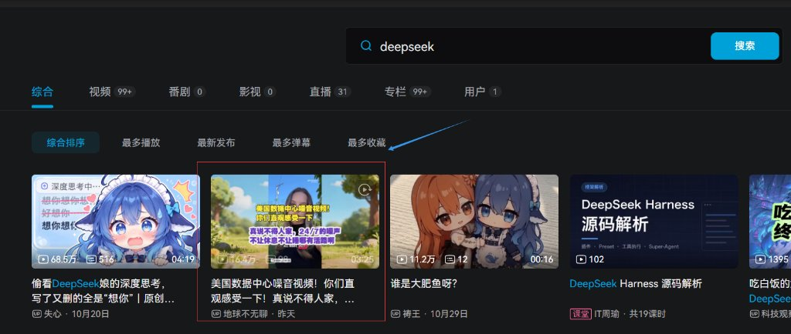

# Bilibili Search Fix

B站搜索结果纯净修复：精准保留与搜索词相关的内容，告别算法杂乱推流与信息流广告。

> **声明与致谢**：本项目原始灵感来源于 [houliabc/bilibili-search-purify](https://github.com/houliabc/bilibili-search-purify)。新版本未采用其代码实现，而是基于现代 B 站底层 API 请求拦截（Fetch / XHR / SSR / Pinia 水合拦截）、确定性标签关联池与无侵入 DOM 协同重构开发，实现了更高精准度、零闪烁与零误杀的纯净检索效果。

---

## 一键安装

> 请确保浏览器已安装脚本管理器扩展：[Tampermonkey（篡改猴）](https://www.tampermonkey.net/) 或 [Violentmonkey（暴力猴）](https://violentmonkey.github.io/)。

👉 **[点击这里一键安装脚本 (Direct Install)](https://raw.githubusercontent.com/NEPHERAovo/bilibili-search-fix/main/bilibili-search-fix.user.js)**

备用镜像链接（如遇 Raw 访问缓慢）：  
👉 **[点击使用镜像一键安装 (FastMirror)](https://fastly.jsdelivr.net/gh/NEPHERAovo/bilibili-search-fix@main/bilibili-search-fix.user.js)**

点击上方链接后，油猴插件将自动识别并弹出安装确认界面，点击“安装”即可开箱即用。

---

## 效果展示

> [!TIP]
> **默认配置说明**：
> 脚本安装后**默认开启「弱关联」与「模糊展示」**。
> - **为什么默认使用模糊展示**：用于直观判断是否发生误判过滤。模糊卡片居中醒目标明「弱相关内容」，鼠标悬停（Hover）即可直接清晰预览，点击任意位置一键直接跳转播放，无需繁琐二次点击。
> - **强烈推荐使用弱关联模式**：弱关联采用 **PEP（分段阈值弹性惩罚）算法**智能统计强相关视频的标签权重（如搜索 `deepseek` 智能关联 `深度思考`、`大肥鱼` 等核心圈子标签；搜索 `minecraft` 智能关联 `我的世界`、`MC` 等中英对照标签），正常打标（$\le 7$ 个标签）享受 100% 满额权重，对单视频恶意堆砌数十个标签的行为实施指数弹性衰减降权门禁，**既不误伤多标签优质视频，又坚决杜绝堆签污染，误杀率远低于严格强关联模式**。

### 1. 默认模糊展示（标记弱相关内容，保留页面布局）

*以搜索「deepseek」为例：强相关及其衍生圈子内容（如「深度思考」、「大肥鱼」等）精准保留；中间夹杂的算法推荐噪音视频被自动居中虚化标记为「弱相关内容」，页面网格对齐原生无突兀空白。*

### 2. 悬停即时清晰预览 + 单击直接跳转播放（告别繁琐二次点击）

*鼠标悬停（Hover）在弱相关卡片上时即时清晰还原（如图中红框指示），直观核验其确实为无关推流（「美国数据中心噪音视频」）；如确需观看，鼠标左键点击任意区域一键直接跳转新标签页播放。*

---

## 核心特性

- **底层数据拦截净化**：在数据交付页面渲染前（Fetch / XHR / Pinia SSR 水合）完成清洗，页面网格原生对齐，无卡片突兀消失的视觉闪烁。
- **双档展示模式**：
  - **模糊展示（默认）**：不相关视频仅虚化覆盖，显示“弱相关内容”，鼠标悬停即可清晰预览，点击任意区域直接打开播放，无需手动二次点击。
  - **直接过滤**：彻底剔除不相关视频与推广卡片，网格紧凑自然。
- **双档过滤强度**：
  - **弱关联（默认 & 推荐）**：基于 PEP 分段阈值算法动态统计强相关视频标签权重，支持中英文对照与衍生别名拓展，自带超标堆签惩罚与跨视频共现校验，**误杀率更低且防污染**。
  - **强关联（严格包含）**：严格要求标题、标签、作者或简介命中搜索关键词，排除分区分类名称泛化干扰，杜绝误放行。
- **零黑名单维护**：无需用户维护任何繁琐易过期的黑名单词库，杜绝词库误杀。
- **极简交互设计**：无额外图标干扰，通过油猴原生菜单即可一键无感切换模式与强度。

---

## 菜单设置项

安装脚本后，点击油猴插件图标即可随时切换模式：

- **展示模式**：
  - `模糊展示 - 点击切换为直接过滤`（当前默认：模糊展示）
  - `直接过滤 - 点击切换为模糊展示`
- **过滤强度**：
  - `弱关联（包含相关标签） - 点击切换为强关联`（当前默认：弱关联）
  - `强关联（严格包含） - 点击切换为弱关联`

---
